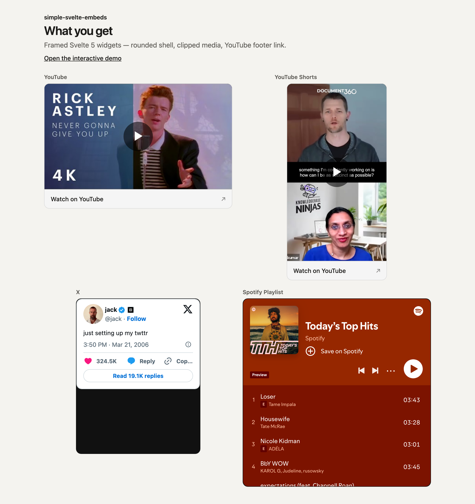

# simple-svelte-embeds

Drop-in iframe embeds for Svelte 5. One import, one component, a real iframe — no SDKs, no adapters, no runtime dependencies.

<picture>
  <source media="(prefers-color-scheme: dark)" srcset="docs/assets/widgets-overview-dark.png" />
  
</picture>

```bash
npm install simple-svelte-embeds
```

```svelte
<script>
	import YouTube from 'simple-svelte-embeds/YouTube.svelte';
</script>

<YouTube id="dQw4w9WgXcQ" title="Never Gonna Give You Up" />
```

Poster first. Tap to play. Framed shell with a YouTube footer — not a floating link. Live gallery: `npm run demo` then open `/gallery`.

## Why this exists

Svelte apps usually just need a sized iframe that respects privacy and loads late. This library ships the `.svelte` files themselves — you compile them, tree-shake by path, and leave player SDKs out of the bundle.

- Svelte 5 runes (`$props`, `$derived`)
- Zero runtime dependencies (`svelte` is an optional peer)
- YouTube uses `youtube-nocookie.com` and a click-to-load facade by default

Works in SvelteKit, Vite + Svelte, and Astro (`@astrojs/svelte`).

## How it feels


YouTube widgets show a poster until someone clicks. Then the real player loads with `autoplay=1`. “Watch on YouTube” sits in the frame footer for click-through.


One frame, three ways to size it:

| Method | Example |
|--------|---------|
| Props | `<YouTube width="40rem" aspectRatio="16 / 9" />` |
| Parent CSS | `--embed-width`, `--embed-height`, `--embed-aspect` |
| Drag | corner handle · arrow keys · `onresize` · `resizable={false}` |

Details: [docs/API.md](docs/API.md).

## Quick start

```svelte
<script>
	import Embed from 'simple-svelte-embeds/Embed.svelte';
	import InstagramReel from 'simple-svelte-embeds/InstagramReel.svelte';
	import SpotifyPlaylist from 'simple-svelte-embeds/SpotifyPlaylist.svelte';
	import Vimeo from 'simple-svelte-embeds/Vimeo.svelte';
	import X from 'simple-svelte-embeds/X.svelte';
	import YouTube from 'simple-svelte-embeds/YouTube.svelte';
	import YouTubeShorts from 'simple-svelte-embeds/YouTubeShorts.svelte';
</script>

<YouTube id="dQw4w9WgXcQ" title="Demo video" width="40rem" />
<YouTubeShorts id="pVRefGmQDJM" title="Short" />
<InstagramReel id="CgdzCoMoUBJ" title="Reel" />
<SpotifyPlaylist id="37i9dQZF1DXcBWIGoYBM5M" title="Playlist" />
<Vimeo id="148751763" title="Demo video" />
<X id="20" title="Post on X" style="width: 24rem; aspect-ratio: 4 / 5" />
<Embed src="https://example.com/embed" title="Custom embed" />
```

Astro:

```astro
---
import YouTube from 'simple-svelte-embeds/YouTube.svelte';
---
<YouTube client:visible id="dQw4w9WgXcQ" title="Demo" />
```

Import the file you need: `simple-svelte-embeds/YouTubeShorts.svelte`. Unused platforms stay out of the graph.

## Widgets

YouTube, Vimeo, Instagram, X, Facebook, TikTok, Spotify, SoundCloud, Reddit, CodePen, Bluesky, Gist, plus a generic `Embed`.

Named components per content type (`YouTubeShorts`, `SpotifyPlaylist`, `XPost`, …). Full list and props: [docs/API.md](docs/API.md).

## Try the demo

```bash
npm install --prefix demo
npm run demo
```

Open `/` to poke one widget at a time, or `/gallery` for the overview used above. SvelteKit app in `demo/`, ready for Cloudflare Workers. Not part of the published package.

## Develop

```bash
npm install
npm run check
npm test
```

Published artifact is `src/` — no build step. CI runs against `svelte@latest`; Dependabot opens weekly Svelte bumps.

API · [docs/API.md](docs/API.md) · Design · [docs/DESIGN.md](docs/DESIGN.md)

## License

[MIT](LICENSE)
